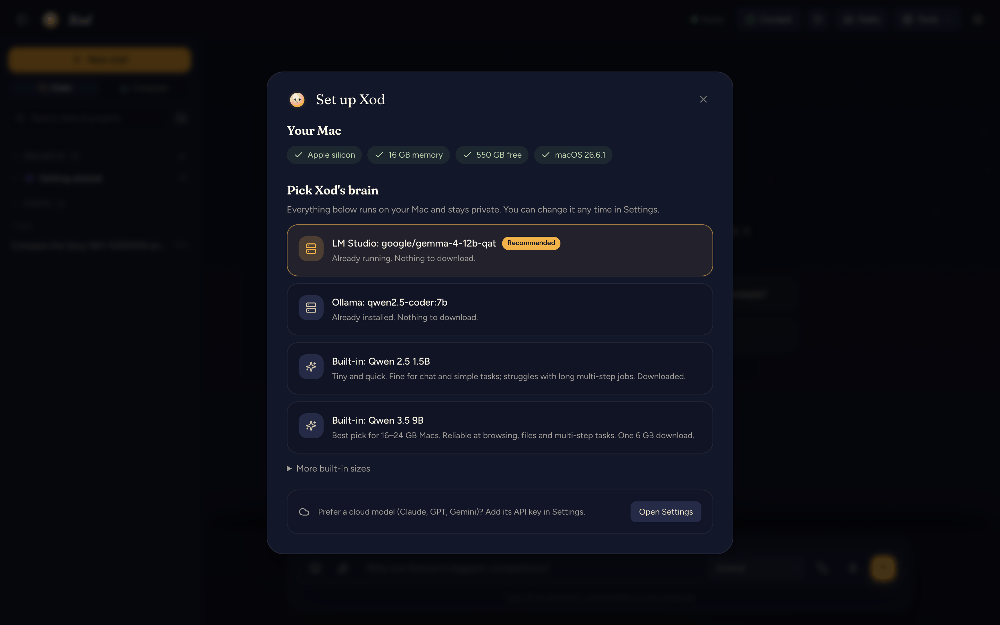

# Xod

**A private AI that works on your Mac while you're away, and gets better at your tasks every week.**

Xod runs on your own Mac with a local model. It researches the web with its own browser, works with your files, makes images and video on-device, and takes on whole jobs in the background. It stops and asks before anything is sent, paid, posted or deleted, and every change it makes to your files can be undone.

[](LICENSE)
[](https://python.org)
[](#requirements)


## What you can hand it

- **"Every weekday at 8, give me the five biggest tech stories with sources."** Save it once as a routine; Xod runs it on schedule and the report is waiting for you.
- **"Find the junior Python roles on these three job boards and fill in the applications."** Xod works through the sites in its own browser and pauses for your OK before each submit.
- **"Tidy my Downloads folder and tell me what's taking the space."** It sorts the files, shows you exactly what it moved, and one click puts everything back.

## Why Xod

- **Private by default.** Chats, files, voice and images stay on your Mac. Pick a model in LM Studio or Ollama, or use Xod's built-in engine (no other apps needed).
- **It does things, not just chat.** A real browser, your files, the terminal, background jobs, a task inbox that keeps working when you walk away.
- **You stay in charge.** Approval for every outward action, an activity log of everything it did, and undo for file changes.
- **Teach once, repeat forever.** Turn any chat or task into a routine; Xod remembers the steps that worked and re-checks them each run.
- **It learns from its mistakes.** When a step fails, Xod repairs it, remembers the fix, and can train small on-device models on its own work.
- **Plays well with your other AI apps.** Uses any MCP tool (email, calendars, Notion, GitHub…) and lets Claude Desktop, Cursor and others hand work to Xod.
- **Cloud only when it helps.** Optionally hand the hard steps to Claude, GPT or Gemini, with your permission, shown costs, and a monthly budget.

## Install

### Desktop app

1. Download `Xod-<version>-arm64.dmg` (about 600 MB) from [Releases](../../releases) and open it.
2. Drag **Xod** onto **Applications**.
3. Open Xod. Everything it needs is already inside the app, so it's ready in seconds; a short setup helps you pick an AI model.

> The app isn't signed by Apple yet, so macOS will warn the first time: right-click Xod.app → **Open**, or allow it in System Settings → Privacy & Security.

### From source

```bash
git clone https://github.com/your-username/xod.git
cd xod
./run.sh                      # sets up .venv the first time, then serves http://localhost:8000
```

Or run the desktop shell from source: `cd electron && npm install && npm start`.

The first time you open Xod, a short setup checks your Mac and helps you choose a model:

| Your Mac | Suggested model | Download |
|---|---|---|
| 8 GB | Qwen 3.5 4B (built-in engine) | 3.1 GB |
| 16–24 GB | Qwen 3.5 9B (built-in engine), or any model you already run in LM Studio / Ollama | 6 GB |
| 32 GB+ | Qwen 3.8 27B (built-in engine) | 16 GB |



## A quick tour

**Routines.** Jobs Xod repeats for you, by hand or on a schedule. Each run shows up in Tasks and still asks before sending or paying.


**Activity and undo.** Everything Xod did, in plain words. File writes, edits, moves and trash can be undone; Xod won't overwrite a file you changed afterwards without asking.


**Shareable reports.** Turn any answer into a polished page and PDF with numbered sources, ready to send.


**Connected apps (MCP).** Paste a server's config to give Xod new tools; secrets go into your Keychain. Copy the snippet shown to use Xod from Claude Desktop, Cursor or Claude Code.


**Add-ons.** Specialist abilities are optional packs: startup and market intel, people and email lookup, website forensics, creators and trends, Media Studio and Model Lab.


Also in the box: on-device images and video (FLUX, AnimateDiff), voice input transcribed on your Mac (Whisper), long-term memory, projects to organize chats and files, a self-check that fixes common problems, and a gated way for Xod to improve its own code (with tests, approval and one-click revert).

## Requirements

- A Mac with Apple silicon (M1 or newer). 16 GB of memory is comfortable; 8 GB works with the small model.
- macOS 13 or newer, Google Chrome (Xod's browser), and about 10 GB of free space for the app and a model.
- Python 3.10+ only if you run from source (the desktop app brings its own).

## Privacy and security

- **Your data stays on your Mac**, in `~/Library/Application Support/Xod`, readable only by your user account. No telemetry. Set `XOD_DATA_DIR` to keep it elsewhere.
- **Keys and logins live in the macOS Keychain**, never in files, logs or prompts.
- **Local only:** the server listens on `127.0.0.1` and refuses requests from websites (Host and Origin checks), so a page you visit can't drive Xod.
- **Untrusted text stays text:** everything the AI writes is sanitized before it's shown, the UI runs under a strict Content-Security-Policy, and all UI code is bundled at pinned versions.
- **It asks first** before any submit, send, payment, post or delete on a website, and before running outside (MCP) tools that change things.
- **Audited dependencies:** exact versions with no known vulnerabilities when pinned; CI re-checks weekly.

Found a security problem? Please report it privately; see [SECURITY.md](.github/SECURITY.md).

## For developers

```
xod/
├── app/
│   ├── main.py              # FastAPI server and API
│   ├── paths.py             # where personal data lives (outside the repo)
│   ├── mcp_server.py        # Xod as an MCP server for other apps
│   ├── agent/               # planner, tools, self-healing, evidence board
│   ├── services/            # browser, files, memory, tasks, routines, activity, reports,
│   │                        #   local engine, model routing, MCP client, media, packs…
│   ├── static/              # the web UI (vanilla JS + Tailwind, libraries vendored)
│   └── vendor/              # mflux (MIT), patched
├── electron/                # desktop app and .dmg installer (cd electron && npm run dist)
├── docs/                    # roadmap and screenshots
├── scripts/                 # release checker, screenshots
├── tests/                   # end-to-end suites
└── run.sh
```

Tests: `.venv/bin/python tests/features/run_features_test.py` (and the suites in `tests/self_heal` and `tests/self_edit`). They use a throwaway data folder, never yours. See [CONTRIBUTING.md](.github/CONTRIBUTING.md).

## License

[MIT](LICENSE). Bundled third-party code keeps its own license (see `app/vendor/` and `app/static/vendor/`).
