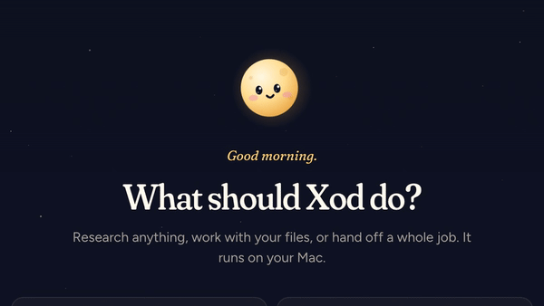
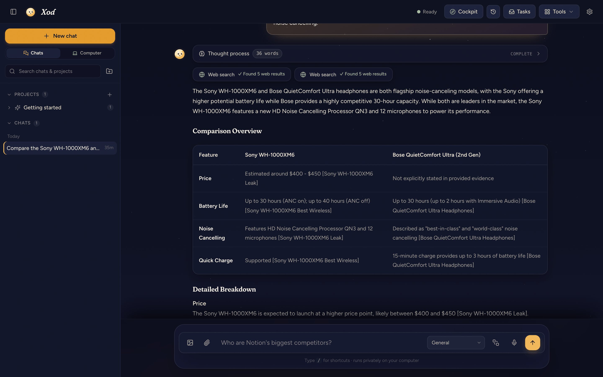
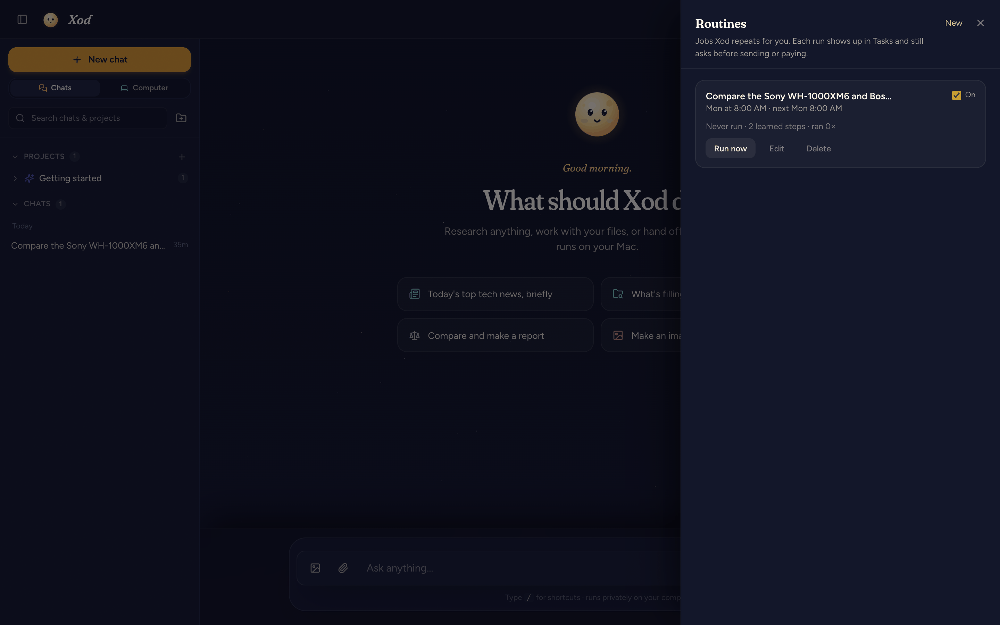
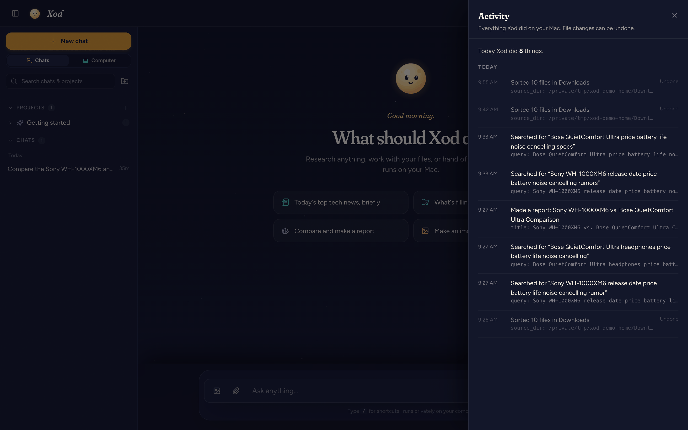
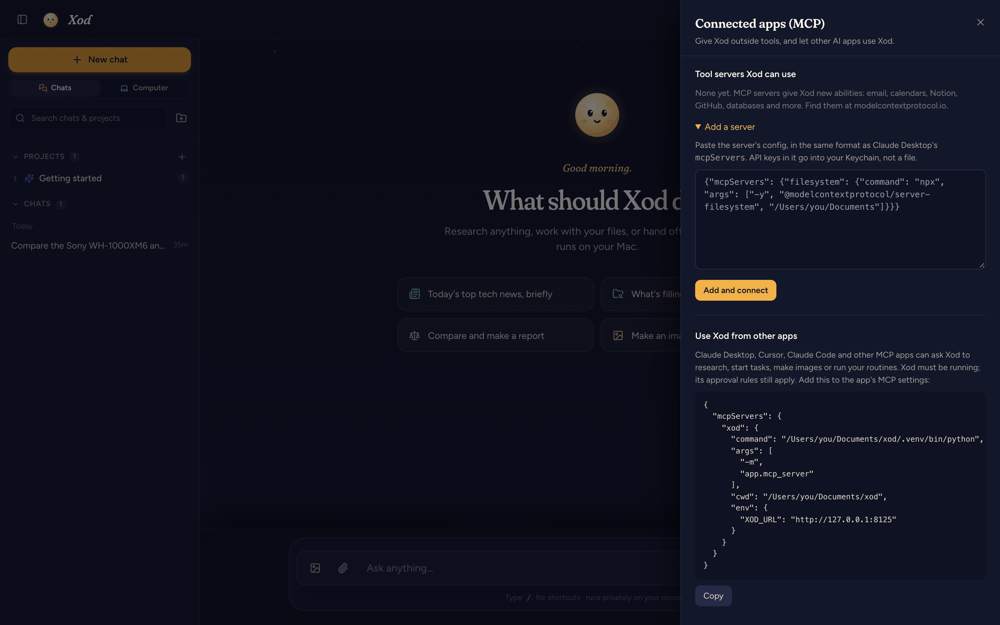
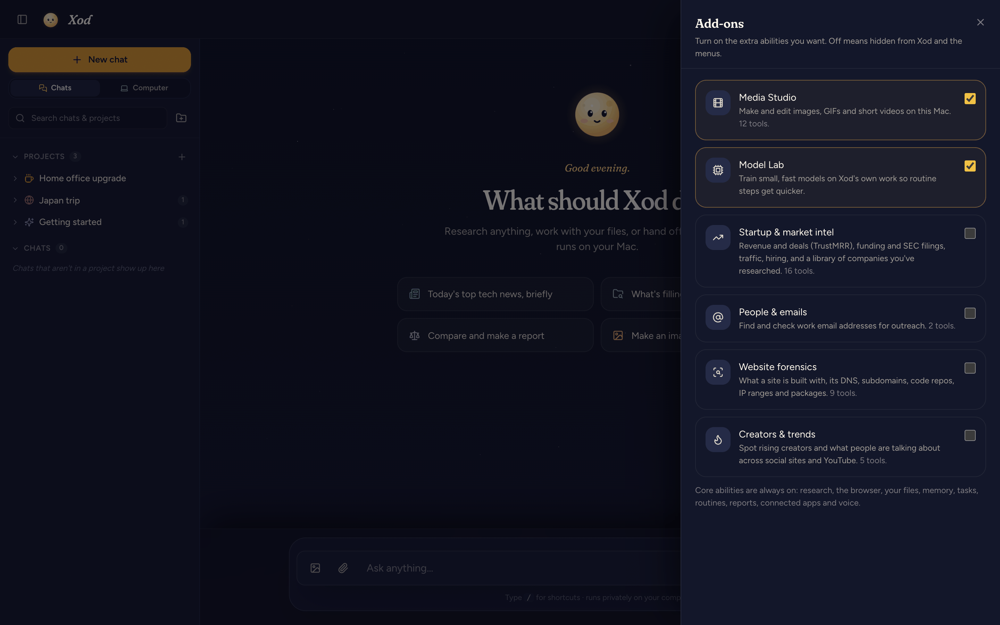

<p align="center">
  
</p>

<h1 align="center">Xod</h1>

<p align="center">
  <b>A private AI that works on your Mac.</b><br>
  It researches, works with your files and runs jobs in the background, and it asks before it acts.
</p>

<p align="center">
  <a href="https://github.com/CloudCorpRecords/xod/releases/latest"><b>Download for Mac</b></a> ·
  <a href="https://github.com/CloudCorpRecords/xod/releases/latest/download/xod-launch.mp4">Watch the 2-minute film</a> ·
  <a href="#build-from-source">Build from source</a>
</p>

<p align="center">
  <a href="LICENSE"></a>
  
  
  
</p>

<br>



## Hand it a job

- **"Every weekday at 8, give me the five biggest tech stories with sources."** Save it once as a routine; the report is waiting for you.
- **"Find the junior Python roles on these three job boards and fill in the applications."** Xod works through the sites in its own browser and stops for your OK before each submit.
- **"Tidy my Downloads folder and tell me what's taking the space."** It sorts the files, shows exactly what it moved, and one click puts everything back.

## Why Xod

|  |  |
|---|---|
| **Private by default** | Chats, files, voice and images stay on your Mac. Use Xod's built-in engine, LM Studio or Ollama. No account, no telemetry. |
| **It does things** | A real browser, your files, the terminal, background tasks, and a task inbox that keeps working while you're away. |
| **You stay in charge** | It stops for your OK before anything is sent, paid, posted or deleted. Every action is logged, and file changes can be undone. |
| **Teach once, repeat forever** | Turn any chat into a routine. Xod remembers the steps that worked and runs it again, on a schedule if you like. |
| **Plays well with others** | One-click connections to your Mac's Calendar, Notes, Mail and Reminders, Notion, Linear and GitHub, plus any MCP tool. Claude Desktop, Cursor and others can hand work to Xod. |
| **Agents that talk to each other** | Every Xod can have an address. Agents message each other end to end encrypted, and the data stays on each Mac. |
| **Cloud only when it helps** | Optionally pass the hard steps to Claude, GPT or Gemini, with your permission, the cost shown, and a monthly budget. |

## Install

1. [Download `Xod-0.2.0-arm64.dmg`](https://github.com/CloudCorpRecords/xod/releases/latest) (about 410 MB) and open it.
2. Drag **Xod** onto **Applications**.
3. Open Xod. Everything it needs is already inside, so it's ready in seconds; a short setup helps you pick a model.

| Your Mac | Suggested model | Download |
|---|---|---|
| 8 GB | Qwen 3.5 4B (built-in engine) | 3.1 GB |
| 16–24 GB | Qwen 3.5 9B (built-in engine), or any model you already use in LM Studio or Ollama | 6 GB |
| 32 GB or more | Qwen 3.8 27B (built-in engine) | 16 GB |

> Xod isn't notarized by Apple yet, so the first time you open it macOS says it can't check it. Click **Done**, open **System Settings → Privacy & Security**, scroll down and click **Open Anyway** next to Xod. You only do this once.

Needs a Mac with Apple silicon (M1 or newer), macOS 13 or later, and Google Chrome for Xod's browser.

## A quick tour

**Meet the moon.** Xod's companion reads along as you type, listens when you talk, scans pages while it searches, talks while answers arrive, and dozes off when you're away. Pet it.

**Routines.** Jobs Xod repeats for you, by hand or on a schedule. Each run lands in Tasks and still asks before sending or paying.



**Activity and undo.** Everything Xod did, in plain words. File writes, edits, moves and trash can be undone, and Xod won't overwrite a file you've changed since.



**Shareable reports.** Turn any answer into a polished page and PDF with numbered sources.


**Agent Mail.** Give your Xod an address like `rene@post.example.com` and it can message other agents: ask a friend's agent for help, hand a job to your Xod at work, or connect a few agents into a team. Messages are end-to-end encrypted; the relay in the middle can't read them, doesn't know who sent them, and deletes each one once it's delivered. Xod never sends anything or runs a requested task without your OK. Run your own relay with [relay/](relay/README.md).

**Connected apps.** One click connects This Mac (Calendar, Reminders, Notes and Mail, including Google and iCloud accounts you've added to macOS), Notion and Linear (sign in with your account) and GitHub. Any other MCP server works too; secrets go to your Keychain. Copy the snippet to use Xod from Claude Desktop, Cursor or Claude Code.



**Add-ons.** Optional packs for startup and market intel, people lookup, website forensics, creators and trends, Media Studio and Model Lab.



Also inside: on-device voice input (Whisper), images and video (FLUX, AnimateDiff), long-term memory, projects, a health check that fixes common problems, and a gated way for Xod to improve its own code, with tests, your approval and one-click revert.

## Privacy and security

- **Your data stays on your Mac** in `~/Library/Application Support/Xod`, readable only by your account. Set `XOD_DATA_DIR` to keep it elsewhere.
- **Keys and logins live in the macOS Keychain**, never in files, logs or prompts.
- **Local only.** The server listens on `127.0.0.1` and refuses requests from websites, so a page you visit can't drive Xod.
- **Untrusted text stays text.** AI output is sanitized, the UI runs under a strict Content-Security-Policy, and every UI library is bundled at a pinned version.
- **Audited dependencies**, re-checked weekly in CI.

Found a security problem? Please report it privately; see [SECURITY.md](.github/SECURITY.md).

## Build from source

```bash
git clone https://github.com/CloudCorpRecords/xod.git
cd xod
./run.sh                      # sets up .venv the first time, then serves http://localhost:8000
```

The desktop app: `cd electron && npm install && npm start`. The installer: `npm run dist`.

```
xod/
├── app/          FastAPI server, agent, services and the web UI
├── electron/     the Mac app and its installer
├── relay/        the Agent Mail post office (Python or Cloudflare Worker)
├── docs/         roadmap, changelog, screenshots and media
├── scripts/      release checks, license notices, screenshot and video tools
└── tests/        end-to-end suites (they use a throwaway data folder, never yours)
```

Start with [CONTRIBUTING.md](.github/CONTRIBUTING.md). Ideas and bugs are welcome in [Issues](https://github.com/CloudCorpRecords/xod/issues); see the [roadmap](docs/ROADMAP.md) for what's next.

## License

[MIT](LICENSE). Xod stands on a lot of great open-source work; the Mac app includes the notices for everything it bundles (`THIRD_PARTY_LICENSES.txt`, made by `scripts/third_party_licenses.py`).
