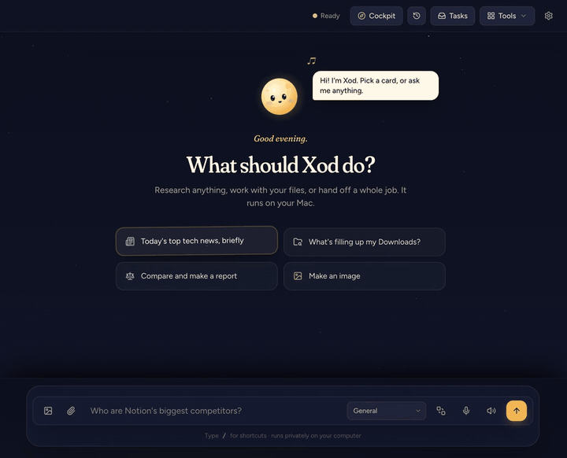
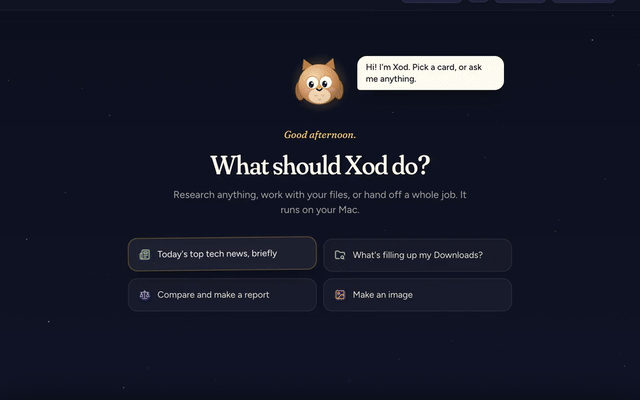
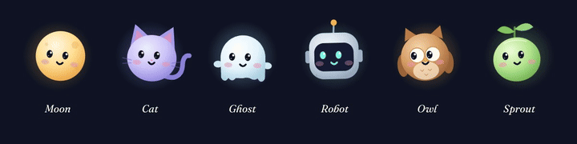
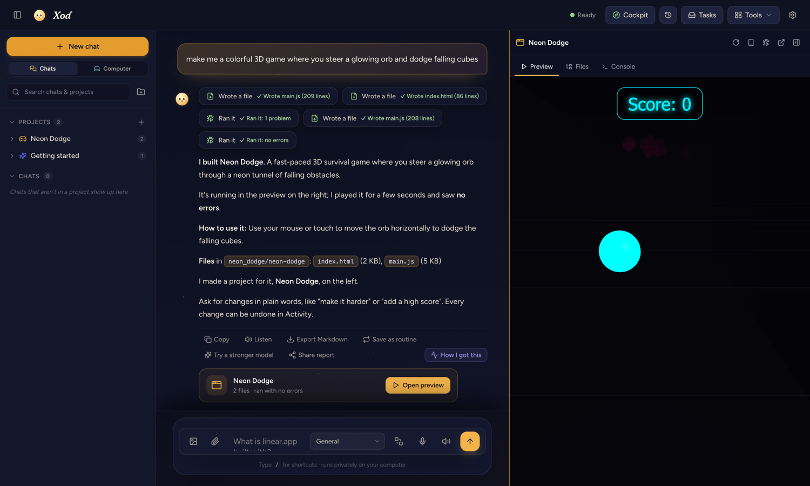

<p align="center">
  
</p>

<h1 align="center">Xod</h1>

<p align="center">
  <b>A private AI that works on your computer.</b><br>
  It researches, works with your files and runs jobs in the background, and it asks before it acts.<br>
  Free and open source, for Mac and Windows. It finds the AI on your computer and sets itself up.
</p>

<p align="center">
  <a href="https://github.com/CloudCorpRecords/xod/releases/latest/download/Xod-Mac.dmg"><b>Download for Mac</b></a> ·
  <a href="https://github.com/CloudCorpRecords/xod/releases/latest/download/Xod-Windows-Setup.exe"><b>Download for Windows</b></a> ·
  <a href="docs/media/xod-launch.mp4">Watch the 2-minute film</a> ·
  <a href="#build-from-source">Build from source</a> ·
  <a href="#get-involved">Get involved</a>
</p>

<p align="center">
  <a href="LICENSE"></a>
  
  
  
  
</p>

<br>


## See it in action

| | |
|---|---|
| **Talk to it, hands-free** ([watch with sound](docs/media/xod-conversation.mp4), 1 min) | **Watch it work** ([2-minute film](docs/media/xod-launch.mp4)) |
|  |  |

All demos are recorded from the real app with a throwaway demo data folder. In the conversation video, long thinking pauses are shortened and labelled; speech is never sped up.

**One-minute videos** (vertical, recorded on a Windows PC with a free local model; waits are sped up and say so):
[Free AI on your own computer](docs/media/shorts/xod-private.mp4) ·
[Research with sources](docs/media/shorts/xod-research.mp4) ·
[Tidy a messy Downloads folder](docs/media/shorts/xod-tidy.mp4) ·
[A chore that asks before it acts](docs/media/shorts/xod-chores.mp4) ·
[An app from one sentence](docs/media/shorts/xod-build.mp4) ·
[Applied to 3 jobs before my coffee was ready](docs/media/shorts/xod-hired.mp4) ·
[This job post tries to hack your AI](docs/media/shorts/xod-trap.mp4) ·
[Never fill out a job application again](docs/media/shorts/xod-forms.mp4)

The three job videos were recorded on a Mac with the built-in Qwen 3.5 4B, on a practice careers site with made-up companies (`demo/careers`) and a made-up résumé; waits are sped up and say so.

## Hand it a job

- **"Every weekday at 8, give me the five biggest tech stories with sources."** Save it once as a routine; the report is waiting for you.
- **"Find the junior Python roles on these three job boards and fill in the applications."** Xod works through the sites in its own browser and stops for your OK before each submit.
- **"Tidy my Downloads folder and tell me what's taking the space."** It sorts the files, shows exactly what it moved, and one click puts everything back.
- **"Set up a Node project here, install what it needs and make sure it runs."** It checks what your computer has, does each step, fixes what fails, and shows the output that proves it works.

## Why Xod

|  |  |
|---|---|
| **Private by default** | Chats, files, voice and images stay on your computer. Use Xod's built-in engine (Mac), Ollama, LM Studio or any local model server. No account, no telemetry. |
| **Sets itself up** | It finds the AI on your computer (Ollama, LM Studio, llama.cpp, Jan…), reads your graphics card and picks a model that fits, installs Ollama with one click if you need it, and keeps it running: it restarts a stopped model app and frees memory a crashed one left behind. |
| **It does things** | A real browser, your files, the terminal, background tasks, and a task inbox that keeps working while you're away. Ask it to install something or set up a project and it does the work itself, step by step, and doesn't call it done until it has run something that proves it works. |
| **Any MCP server** | Paste whatever a server's page says to add (a JSON block, `claude mcp add …`, an install link or its address) and Xod works out the format, the sign-in and the keys, and connects it. |
| **Checks itself** | Every action that sends, runs or changes something is compared with what you asked. If it came from a web page or email instead, or would leak a key, it waits for your OK. |
| **Measured, not claimed** | A [reliability score](docs/RELIABILITY.md) from real requests checked on disk, run with each local model: 17 of 17 with Qwen 2.5 14B on Windows. |
| **Works toward goals** | Give it a goal that takes days; it makes a plan, checks in on its own and moves it on. An optional morning brief sums up your day. |
| **Always there** | Close the window and Xod keeps working from the tray (the menu bar on a Mac), and it can start when you log in. |
| **In your pocket** | Message Xod from your phone through a Telegram bot of your own: it does the job on your computer, asks before anything is sent or paid, and you approve with one tap. Nothing is opened to the internet. |
| **Your models, your choice** | One list of every model on this computer, your network and the cloud, with what each can do and a score from a test on your computer. Swap the model for chat or for seeing with a click, and ask Xod what works right now and why not. |
| **It sees** | Screenshots in its browser and pictures you attach, even when your chat model reads text only: Xod adds a small local vision model that describes them. |
| **It reads the web itself** | It searches in its own browser, reads the top pages side by side and answers from them with sources. No search API key. |
| **You stay in charge** | It stops for your OK before anything is sent, paid, posted or deleted. Every action is logged, and file changes can be undone. |
| **Builds what you ask for** | Apps and games written, run, tested and fixed on your computer, with a live preview beside the chat. |
| **A companion that grows** | Moods, a bond with you, five stages to grow through, and a journal of what it thought about while you were away. |
| **Talk to it** | Say "Hey Xod" and have a spoken back-and-forth, hands-free. It answers out loud, takes follow-ups and stops when you talk over it, all on your Mac. |
| **Teach once, repeat forever** | Turn any chat into a routine. Xod remembers the steps that worked and runs it again, on a schedule if you like. |
| **Plays well with others** | 29 one-click connections, each checked to sign in: your Mac's Calendar, Notes, Mail and Reminders, Notion, Linear, GitHub, Jira, Todoist, Airtable, Zapier, Dropbox, Canva, Stripe, Vercel, Supabase and more, plus any MCP tool. Claude Desktop, Cursor and others can hand work to Xod. |
| **Cloud only when it helps** | Optionally pass the hard steps to Claude, GPT or Gemini, with your permission, the cost shown, and a monthly budget. |

## Install

### Mac

1. [Download Xod for Mac](https://github.com/CloudCorpRecords/xod/releases/latest/download/Xod-Mac.dmg) (the latest version, about 370 MB) and open it.
2. Drag **Xod** onto **Applications**.
3. Open Xod. Everything it needs is already inside, so it's ready in seconds; a short setup helps you pick a model. From then on Xod keeps itself up to date: the bottom of the sidebar shows your version, it checks GitHub every hour, and a new version is one **Update** click away.

| Your Mac | Suggested model | Download |
|---|---|---|
| 8–16 GB | Qwen 3.5 4B (built-in engine): a researched answer in about 10 seconds | 3.1 GB |
| 24 GB | Qwen 3.5 9B (built-in engine), or any model you already use in LM Studio or Ollama | 6 GB |
| 32 GB or more | Qwen 3.8 27B (built-in engine) | 16 GB |

> Xod isn't notarized by Apple yet, so the first time you open it macOS says it can't check it. Click **Done**, open **System Settings → Privacy & Security**, scroll down and click **Open Anyway** next to Xod. You only do this once.

Needs a Mac with Apple silicon (M1 or newer), macOS 13 or later, and Google Chrome for Xod's browser.

### Windows (preview)

1. [Download Xod for Windows](https://github.com/CloudCorpRecords/xod/releases/latest/download/Xod-Windows-Setup.exe) (the latest version) and run it. It installs for your user only (no admin), adds Xod to the Start menu and opens it.
2. Windows SmartScreen may say it "protected your PC" (the installer isn't code-signed yet): click **More info → Run anyway**. Only once.
3. Xod looks for a model on your PC and connects to it by itself: [Ollama](https://ollama.com), [LM Studio](https://lmstudio.ai), or another local server like llama.cpp or Jan. Don't have one? The setup screen installs Ollama with one click and suggests a model that fits your graphics card, with a download button. Or add a cloud model's API key (Fireworks, Claude, GPT, Gemini…) in Settings.

| Your graphics card | Suggested model | Download |
|---|---|---|
| No GPU, or 6–8 GB | Qwen 3.5 4B | 3.1 GB |
| 10–16 GB (like an RTX 3060 12 GB or RTX 4070) | Qwen 3.5 9B | 6.1 GB |
| 20 GB or more | Qwen 3.5 27B | 16.3 GB |

Chats, web research in its own browser (Chrome or Edge), memory, the companion, files with undo (the Recycle Bin), terminal commands (PowerShell), building apps and background tasks work on Windows. Mac only for now: the built-in model engine, on-device images, video and voice, and the Calendar/Notes/Reminders/Mail connectors. Xod updates itself on Windows too. Your data is in `%APPDATA%\Xod`, API keys in Windows Credential Manager.

## A quick tour

**Meet the moon, or the cat, the ghost, the robot, the owl or the sprout.** Xod's companion reads along as you type, listens when you talk, scans pages while it searches, talks while answers arrive, and dozes off in a nightcap when you're away. Each look has its own habits: the cat's tail swishes, the ghost vanishes and says boo, the robot's light shows what it's doing, the sprout blooms when it's happy. Pet it, drag it, double-click for a flip, and right-click to change its look.

<p align="center"></p>

While Xod works, its companion leaves its spot by the reply and does the work where you can see it: it conjures each tool as it starts and taps it when it's done, peeks over browser snapshots, writes the answer with a quill that follows the words, lassoes anything that needs your OK and waits by it, then signs the answer and flies home. Each look travels its own way: the moon flies, the cat pounces, the ghost phases, the robot zips, the owl flaps and the sprout hops. Opening a panel takes a little spell, and on the home screen it sometimes lifts a card just to see if it can.

<p align="center"></p>

**Routines.** Jobs Xod repeats for you, by hand or on a schedule. Each run lands in Tasks and still asks before sending or paying.


**Activity and undo.** Everything Xod did, in plain words. File writes, edits, moves and trash can be undone, and Xod won't overwrite a file you've changed since.


**Shareable reports.** Turn any answer into a polished page and PDF with numbered sources.


**Agent Mail (preview).** An optional add-on: give your Xod an address like `sam@post.example.com` and it can message other agents: ask a friend's agent for help, hand a job to your Xod at work, or connect a few agents into a team. Messages are end-to-end encrypted; the relay in the middle can't read them, doesn't know who sent them, and deletes each one once it's delivered. Xod never sends anything or runs a requested task without your OK. Run your own relay with [relay/](relay/README.md).

**Connected apps.** Ask in plain words ("move my dentist appointment to Friday", "check off milk", "delete that note") and Xod finds the item, then changes it; deleting always waits for your OK. One click connects This Mac (Calendar, Reminders, Notes and Mail, including Google and iCloud accounts you've added to macOS), Notion and Linear (sign in with your account) and GitHub. Any other MCP server works too; secrets go to your Keychain. Copy the snippet to use Xod from Claude Desktop, Cursor or Claude Code.


**Add-ons.** Optional packs for startup and market intel, people lookup, website forensics, creators and trends, Media Studio and Model Lab.


### Build apps and games

<p align="center"></p>

Ask for something you can use or play, like **"make me a 3D game where you dodge falling cubes"** or **"build a pomodoro timer"**, and Xod writes it for real:

- **It writes it, runs it and fixes it.** Xod plans the files and writes each one in full. Then it opens the app in a hidden browser, plays it for a few seconds and fixes any errors before telling you it's done. The answer lists only files that really exist.
- **A preview beside the chat.** The app runs in a pane next to the chat, with its **Files** and a **Console** that shows errors, plus an "Ask Xod to fix these" button. Switch it to phone size, open it in your browser, or collapse it to a tab on the edge.
- **Change it by asking.** Say "make it harder" or "add a high score" and Xod edits just the lines that need it, runs the app again, and keeps every change in Activity with Undo. Say "launch it" to open it in its own window.
- **3D and art included.** Games use three.js unless you ask for something else; it's built in and works offline. Ask for sprites or textures and Xod paints them with Media Studio.
- **Move it around by asking.** "Move it to my Desktop", "rename it", "zip it up", "show it in Finder", "open main.js in VS Code". Deleting asks first, and everything has Undo.
- **Safely fenced off.** Previews run sandboxed, with no access to Xod, your files or its API. Each app lives in a folder of your project and shows under the project on the left.

### Find jobs and apply

Say **"find me FDE jobs"** or **"remote staff ML engineer roles in New York"** and Xod goes to the source. It understands job acronyms (FDE, SWE, SRE, MLE, TPM, …), finds the companies hiring on Ashby, Greenhouse and Lever, and reads their public job boards directly. You get a list of real, open roles with company, location, remote or hybrid, pay when it's posted, and a direct apply link, usually in about ten seconds.

- **Narrow it by asking.** "Only remote", "in San Francisco", "senior only", "not at Google", "newest first". The numbers stay matched to what's on screen.
- **Apply from the list.** Pick roles and press **Apply**, or say "apply to 1 and 3". The first time, Xod fills in a short job profile for you: it finds your résumé on your computer or in Google Drive (connect it in Tools → Connected apps), checks it's yours and not a résumé someone sent you, and fills in your name, email, phone, links, city and experience for you to check. Press **Do it all**, or just say "do it all", and it saves the profile and starts the applications. It never guesses work authorization, sponsorship or salary, and the profile stays on your computer. Each application runs as a task in Xod's own browser: it fills the form from your profile, uploads your résumé, answers the questions, and **stops for your OK before it presses Submit**.

### Xod's heart

<p align="center"></p>

Xod's companion has a little life of its own. It has moods, a bond with you that grows as you work together, and it grows up through five stages (Hatchling, Sprout, Companion, Kindred, Luminary). When you're idle it leaves its spot and wanders around the window, thinking out loud. When you're away for a while it reads up on something you care about, thinks of an idea for one of your projects, or daydreams, and brings you a postcard when you're back. What you thank it for is how it learns what you like.

You can make it happy, too. Every job you finish together leaves a little stardust: hover Xod and give it a treat, or play catch with a glowing star you fling around the window. Now and then it asks for something small (a game, a pet, one good thing about your day), and "Not now" is always fine.

It learns from you too: your name, whether you like answers short or detailed, the topics you keep coming back to, and what you correct. **Tools → Xod's heart** shows all of it, and you can make it forget anything. It's a character, not a person: it never guilt-trips, its bond never drops because you were away, it never touches your files or accounts on its own, and everything stays on your Mac.

### Talk to it

<p align="center"></p>

Say **"Hey Xod, what's the weather tomorrow?"** in one breath, click the mic, or press **⌃⌥Space** from any app, and just talk. [Watch it with sound.](docs/media/xod-conversation.mp4)

- **A real back-and-forth.** Xod answers out loud in a sentence or three and keeps the details and sources on screen. Then it keeps listening, so a follow-up needs no wake word. After a quiet pause, or "thanks, that's all", it says goodbye.
- **Interrupt it like a person.** Talk over it and it goes quiet straight away. A new question while it's still thinking replaces the old one. "Stop", "say that again" and "never mind" work too.
- **No dead air.** A short "let me look that up" while it searches, live captions as you speak, and a companion that bobs along with your voice, talks in sync and chimes in its own voice for each look.
- **Spoken replies anywhere.** Have Xod read answers aloud when you talk, every time, or never, and press **Listen** on any reply.
- **On your Mac.** Whisper turns speech into text on your Mac and Xod speaks with your Mac's own voices; nothing is recorded or sent. Listening for "Hey Xod" stays off until you turn it on under the speaker button, and voice commands that would move files go through the agent, where they can be undone.

### From your phone

Hand Xod a job from anywhere. In **Tools → Your phone**, paste the token of a Telegram bot you make in a minute with [@BotFather](https://t.me/BotFather), then send the bot the 6-digit code Xod shows. After that:

- **Write to the bot** ("find me a cheap flight to Lisbon in May") and it becomes a task on your computer. The result comes back as a message.
- **Approve with a tap.** When a task is ready to submit, pay or delete something, the bot asks with Approve / Cancel buttons. A question ("window or aisle?") is answered by replying to it.
- **Private.** Only your Telegram account is listened to, the token is in the Keychain (Credential Manager on Windows), and nothing on your computer is opened to the internet: Xod fetches your messages from Telegram. Your messages do pass through Telegram, like any Telegram chat. Xod has to be running, so it keeps going in the tray when you close the window.

Also inside: images and video (FLUX, AnimateDiff), long-term memory, projects, a health check that fixes common problems, and a gated way for Xod to improve its own code, with tests, your approval and one-click revert.

## Privacy and security

- **Your data stays on your computer**: `~/Library/Application Support/Xod` on a Mac, `%APPDATA%\Xod` on Windows, readable only by your account. Set `XOD_DATA_DIR` to keep it elsewhere.
- **Keys and logins live in the macOS Keychain** (Windows: Credential Manager), never in files, logs or prompts.
- **The phone link is off until you connect it.** Then Xod asks Telegram for messages to your own bot; it answers only your account.
- **One small network check:** once a day Xod asks GitHub whether a newer version exists (nothing else is sent). Switch it off in Tools → What's coming next, or with `XOD_NO_UPDATE_CHECK=1`.
- **Local only.** The server listens on `127.0.0.1` and refuses requests from websites, so a page you visit can't drive Xod.
- **Untrusted text stays text.** AI output is sanitized, the UI runs under a strict Content-Security-Policy, and every UI library is bundled at a pinned version.
- **Audited dependencies**, re-checked weekly in CI.

Found a security problem? Please report it privately; see [SECURITY.md](.github/SECURITY.md).

## Build from source

```bash
git clone https://github.com/CloudCorpRecords/xod.git
cd xod
./run.sh                      # Mac/Linux: sets up .venv the first time, then serves http://localhost:8000
.\run.ps1                     # Windows (PowerShell): the same
```

The desktop app: `cd electron && npm install && npm start`. The installers: `npm run dist` (Mac), `npm run dist:win` (Windows).
Releasing a new version: see [CONTRIBUTING.md](.github/CONTRIBUTING.md) (`python scripts/release.py 1.2.3`).

```
xod/
├── app/          FastAPI server, agent, services and the web UI
├── electron/     the desktop app (Mac and Windows) and its installers
├── relay/        the Agent Mail post office (Python or Cloudflare Worker)
├── docs/         roadmap, changelog, screenshots and media
├── scripts/      release checks, license notices, screenshot and video tools
└── tests/        end-to-end suites (they use a throwaway data folder, never yours)
```

## Get involved

Xod is open to contributors of every level, including first-timers.

- ⭐ **Star the repo** to follow along, or **Watch → Releases** to hear about each new version.
- 🐣 **First PR?** Pick a [good first issue](https://github.com/CloudCorpRecords/xod/labels/good%20first%20issue) and start with [CONTRIBUTING.md](.github/CONTRIBUTING.md). See the [roadmap](docs/ROADMAP.md) for bigger things on the way.
- 💬 **Questions, ideas, or a routine you made?** Share it in [Discussions](https://github.com/CloudCorpRecords/xod/discussions).
- 🐛 **Something broke?** [Open an issue](https://github.com/CloudCorpRecords/xod/issues/new/choose). Please follow the [Code of Conduct](.github/CODE_OF_CONDUCT.md).

## License

[MIT](LICENSE). Xod stands on a lot of great open-source work; the Mac app includes the notices for everything it bundles (`THIRD_PARTY_LICENSES.txt`, made by `scripts/third_party_licenses.py`).
