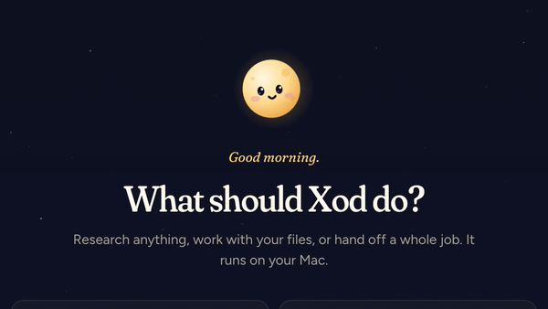
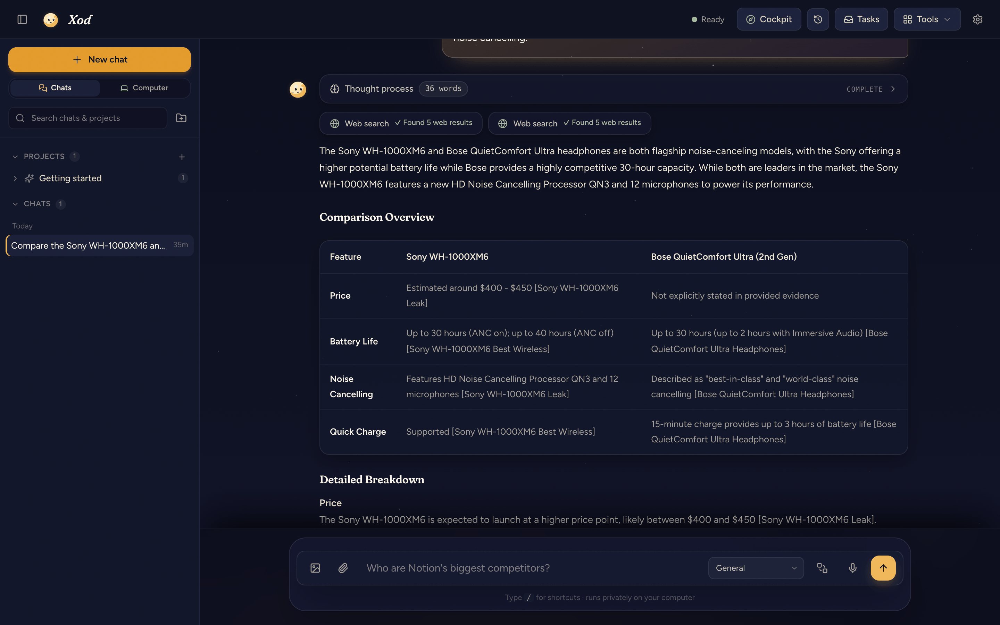
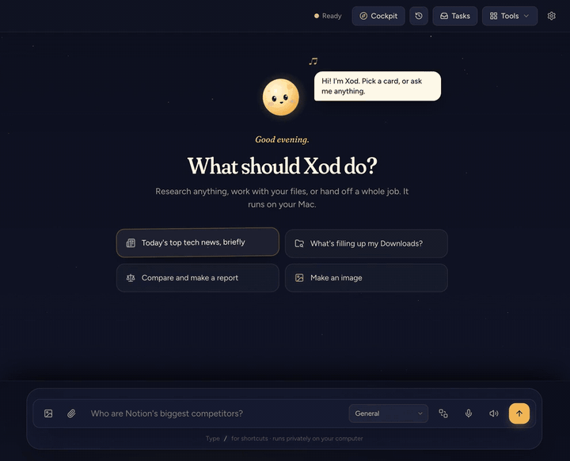
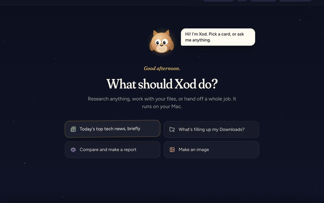

<p align="center">
  
</p>

<h1 align="center">Xod</h1>

<p align="center">
  <b>Approve once. Local. Receipts.</b><br>
  Xod is a local-first AI agent that works inside your already-signed-in Chrome and your Mac apps. You set the scope once, in plain words. Inside that scope it does the job on your machine, with your own keys, and every action lands in an audit log you can read and undo.
</p>

<p align="center">
  <a href="https://www.youtube.com/watch?v=o7nU92CyFSk"><b>Watch the 60-second trailer</b></a>
</p>

<p align="center">
  <a href="https://github.com/CloudCorpRecords/xod/releases/latest/download/Xod-Mac.dmg"><b>Download for Mac</b></a> ·
  <a href="https://github.com/CloudCorpRecords/xod/releases/latest/download/Xod-Windows-Setup.exe"><b>Download for Windows</b></a> ·
  <a href="https://github.com/CloudCorpRecords/xod-android"><b>Android Companion</b></a> ·
  <a href="#quick-start">Quick Start</a> ·
  <a href="docs/CHANGELOG.md">Changelog</a>
</p>

<p align="center">
  <a href="LICENSE"></a>
  
  
  
  
</p>

<br>



---

## Why Xod

Most AI apps stop at text. **Xod is a full personal operating layer** that runs privately on your computer with real browser control, native OS tools, a companion phone app, and an agent-managed fleet — without locking you into a cloud subscription.

| Capability | What Xod Actually Does |
|---|---|
| **Signed-in Chrome & Computer Control** | Reads, focuses, and drafts directly inside your real signed-in Google Chrome (no re-login loops), drives Mac apps via Accessibility, and shows an **Inline Live Action Strip** right in chat with live thumbnails, **Stop**, and **Take Over**. |
| **Quick Actions (Mac + Phone)** | One-click **Post & Web** (Facebook, X, LinkedIn, Threads, Instagram, any site), live **Chrome Tabs** (Focus / Summarize), and Mac **App Launcher** — available identically on Desktop and Android. |
| **Unified Control Center** | One top-bar dashboard showing **AI Brain & Voice**, **Mac Permissions** (1-click Screen Recording & Accessibility), **Apps & MCPs**, **Signed-in Chrome**, and **Fleet Policy** with live attention badges. |
| **32+ Connectors & Smart MCP Routing** | One-click OAuth for **GitHub**, **Notion**, **Zapier (8,000+ apps)**, **Linear**, **Jira**, **Stripe**, **Supabase**, **This Mac**, plus a Universal MCP Importer. **Smart MCP Tool Routing** loads only relevant tools per turn (with `mcp_discover_tools` fallback) for speed and accuracy. |
| **Voice: Offline Local + Real-Time Agora** | Switch inside the bottom Voice popover between **Local (Offline)** (Whisper + Kokoro + *"Hey Xod"*) and **Agora (Real-time)** (BYOK Keychain) — plus **Voice Brief** to speak a 5-part mission out loud and launch it. |
| **Android Companion App** | Pairs effortlessly via **GitHub SSO + Wi-Fi/Tailscale auto-discovery** (with QR & Bluetooth backups). Share links straight from Android into Xod, trigger posts/actions on your Mac browser, see visual proof thumbnails in chat, and **Take Over** screens remotely. |
| **Fleet Control & Cross-Chat Memory** | Connect multiple Xods over Tailscale with **Rubber-Stamp Auto-Approve** (audited in `audit.jsonl`), a **Cross-Chat Agent Bus** (`chat_list`, `chat_read`, `chat_handoff`, `chat_steer`), and a **Shared Fleet Blackboard** + 5-layer memory (`about_you`, `recall.db`, daily logs, checkpoints). |
| **Coding Crew & Builder** | Drive **Claude Code** and **Muse** natively in isolated git worktrees, or build and preview full web/3D apps right beside chat with automated test-and-fix loops. |

---

## See It in Action

| Hands-Free Voice ([video](docs/media/xod-conversation.mp4)) | Live Companion & Tools ([3-min film](docs/media/xod-launch.mp4)) |
|---|---|
|  |  |

---

## Quick Start

### macOS (Apple Silicon, macOS 13+)
1. Download **[Xod-Mac.dmg](https://github.com/CloudCorpRecords/xod/releases/latest/download/Xod-Mac.dmg)** and drag **Xod** to **Applications**.
2. Open Xod — it bundles its own Python runtime, detects local models (**Built-in MLX**, **LM Studio**, **Ollama**) or cloud BYOK keys (**Fireworks**, **OpenAI**, **Anthropic**, **Gemini**, **OpenRouter**), and auto-updates from GitHub.
3. Click **Control** in the top bar to enable **Screen Recording** & **Accessibility** for Mac computer control and connect your apps/MCPs.

> **First launch note:** If macOS shows an unverified developer prompt, open **System Settings → Privacy & Security → Open Anyway** once.

### Windows 10 & 11
1. Download **[Xod-Windows-Setup.exe](https://github.com/CloudCorpRecords/xod/releases/latest/download/Xod-Windows-Setup.exe)** and run it (user-level install, no admin required).
2. Xod auto-detects **Ollama** / **LM Studio** (or installs Ollama in one click) and stores keys in **Windows Credential Manager**.

### Android Companion
- Get the companion app from **[CloudCorpRecords/xod-android](https://github.com/CloudCorpRecords/xod-android)**, sign in with GitHub or join the same Wi-Fi/Tailscale network, and control your Mac from anywhere.

---

## Local-First Privacy & Security

- **100% Local Data:** Chats, episodic recall (`recall.db`), daily logs, and projects stay in `~/Library/Application Support/Xod` (Mac) or `%APPDATA%\Xod` (Windows). Zero telemetry, zero vendor lock-in.
- **Keychain & 1Password Vault:** API keys, OAuth tokens, Agora BYOK keys, and saved logins live in macOS Keychain / Windows Credential Manager (or 1Password `op://` references) — never in plain-text prompts or logs.
- **End-to-End Encrypted Links:** Phone ↔ Computer (Agent Mail) and Fleet ↔ Fleet sync use Tailscale `whois` verification + X25519/ChaCha20-Poly1305/Ed25519 sealing.
- **Audited Autonomy:** You set the scope once; inside it Xod acts without per-action prompts. Fleet/Muse approvals are cryptographically locked to your own devices and recorded in append-only `audit.jsonl` logs.

See [SECURITY.md](.github/SECURITY.md) for responsible disclosure and [docs/RELIABILITY.md](docs/RELIABILITY.md) for measured evals.

---

## Build From Source

```bash
git clone https://github.com/CloudCorpRecords/xod.git
cd xod
./run.sh            # Mac / Linux (creates .venv, serves http://127.0.0.1:8000)
.\run.ps1           # Windows (PowerShell)
```

- **Desktop App:** `cd electron && npm install && npm start`
- **Build Installers:** `npm run dist` (Mac) · `npm run dist:win` (Windows)
- **CLI Mode:** `./xod` (see [docs/TERMINAL.md](docs/TERMINAL.md))

```text
xod/
├── app/          FastAPI backend, agent loop, services (MCP, Fleet, Voice, Browser, Memory) & Moonlit UI
├── electron/     macOS & Windows desktop wrapper and signed installer scripts
├── relay/        Optional self-hosted Agent Mail relay (Python / Cloudflare Worker)
├── docs/         Architecture docs, changelog, reliability evals & media
├── scripts/      Release automation, privacy checks & license generator
└── tests/        Smoke, fleet, desktop, and regression test suites
```

---

## Contributing & Support

- ⭐ **Star the repo** or **Watch → Releases** to follow updates.
- 🐛 **Bugs & Ideas:** [Issues](https://github.com/CloudCorpRecords/xod/issues/new/choose) · [Discussions](https://github.com/CloudCorpRecords/xod/discussions) · [CONTRIBUTING.md](.github/CONTRIBUTING.md)
- ❤️ **Support Xod:** [GitHub Sponsors](https://github.com/sponsors/CloudCorpRecords) · [Stripe](https://donate.stripe.com/3cI3cw2A68eU8sagt7dZ600) · [Official Merch](https://rene-turcios-shop.fourthwall.com)

Licensed under **[MIT](LICENSE)**.
